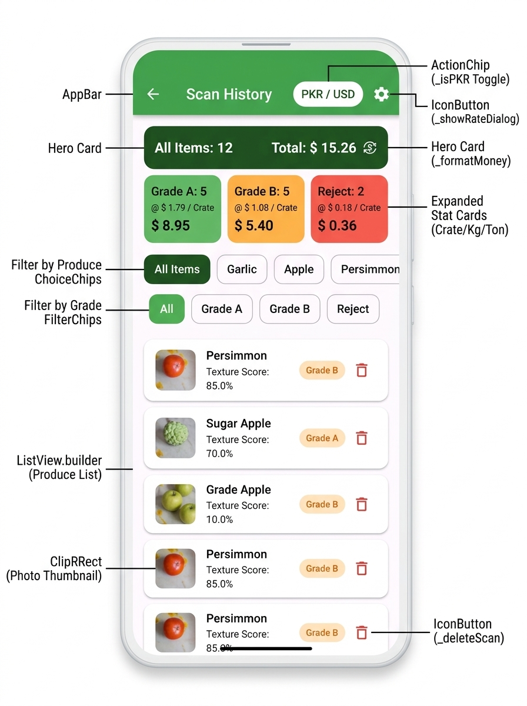
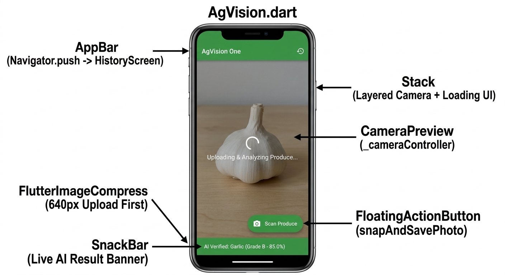
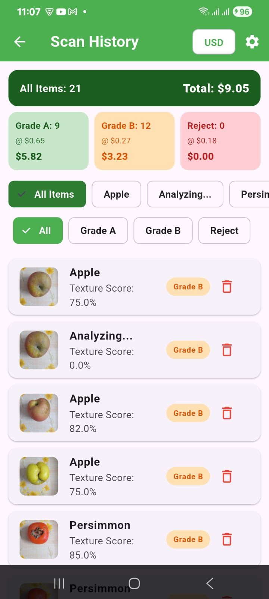
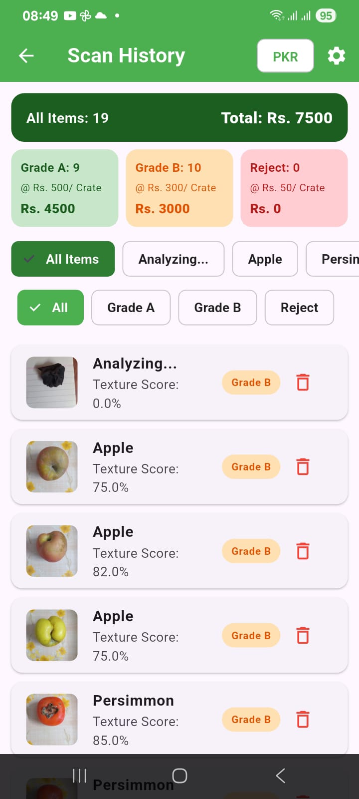
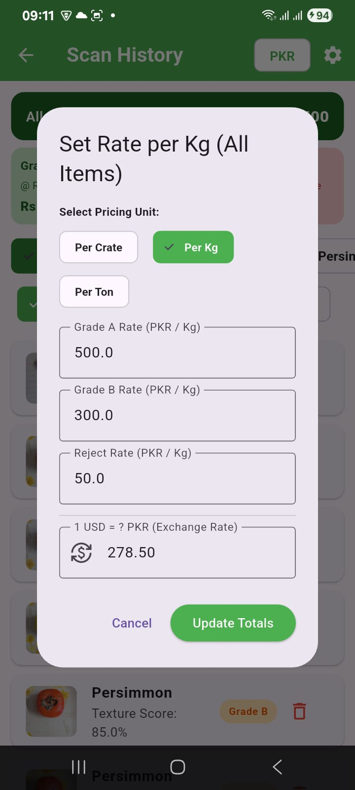
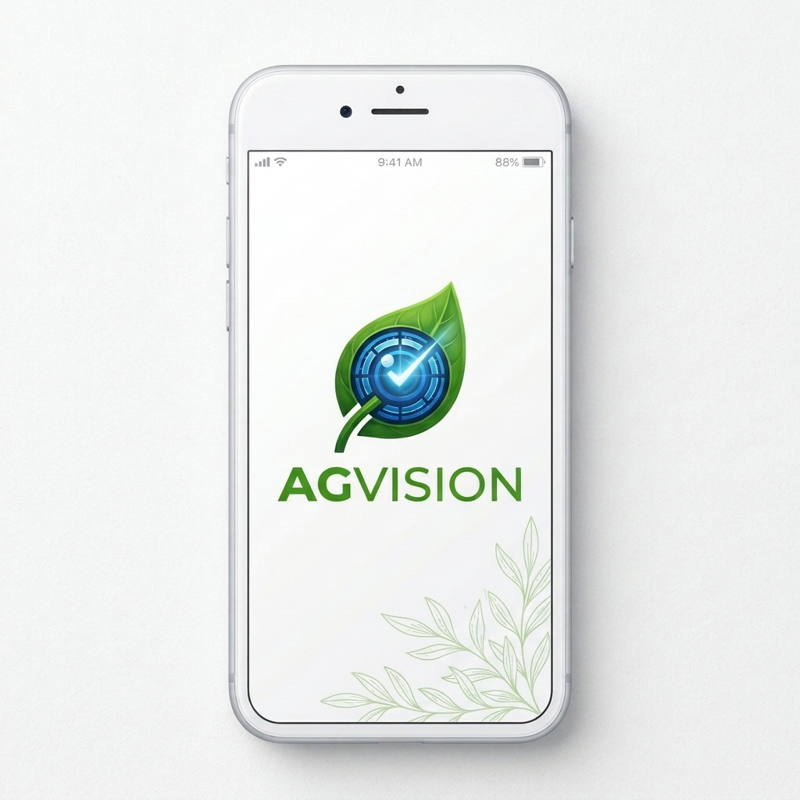
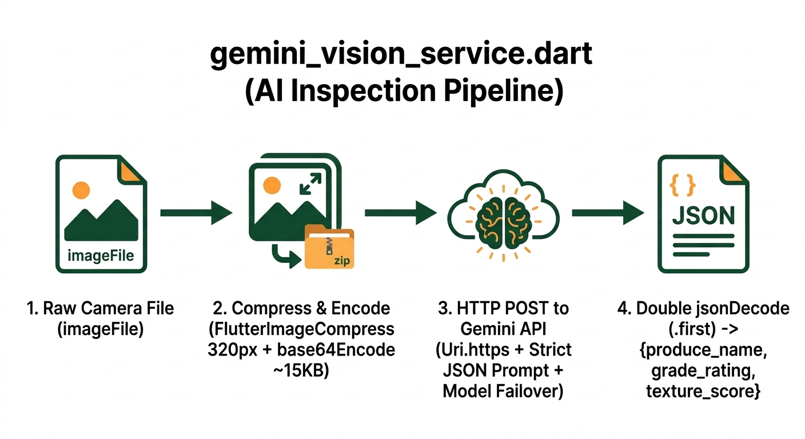

# agvision_scanner

A new Flutter project.

## Getting Started

This project is a starting point for a Flutter application.

A few resources to get you started if this is your first Flutter project:

- [Learn Flutter](https://docs.flutter.dev/get-started/learn-flutter)
- [Write your first Flutter app](https://docs.flutter.dev/get-started/codelab)
- [Flutter learning resources](https://docs.flutter.dev/reference/learning-resources)

For help getting started with Flutter development, view the
[online documentation](https://docs.flutter.dev/), which offers tutorials,
samples, guidance on mobile development, and a full API reference.

# 🌱 AgVision One — AI-Powered Agricultural Produce Quality & Valuation Scanner

> 📲 **Try the Live Android App:** **[Download AgVision One v1.0.0 (APK)](https://github.com)** *(Android 8.0+)*

**`🔵 Flutter 3.x`** • **`🎯 Dart 3.x`** • **`✨ Google Gemini Vision AI`** • **`🟢 Supabase PostgreSQL & Storage`** • **`📄 MIT License`**

**AgVision One** is an end-to-end mobile quality-control and commercial valuation platform built for wholesale agricultural markets, packing houses, and export sorting facilities. Using **Google Gemini Vision AI** and **Supabase**, it grades fruits and vegetables in seconds and calculates real-time batch valuations in **PKR (`Rs.`)** and **USD (`$`)**.

## 📖 How to Use AgVision One (Step-by-Step Guide)

### 1. Scan & Grade Produce (`AgVision` Screen)
1. **Aim the Camera:** Point your phone's rear camera at a fruit, vegetable, or sample crate in clear lighting.
2. **Tap "Scan Produce":** The app immediately compresses and uploads the image to **Supabase Storage** first (preventing data loss on weak mobile networks).
3. **Review AI Verdict:** Within seconds, **Google Gemini Vision AI** analyzes surface texture, blemishes, and ripeness, displaying a color-coded result banner:
   * 🟢 **Grade A (90%–100% Texture Score):** Export-grade quality with zero visible defects.
   * 🟠 **Grade B (70%–89.9% Texture Score):** Minor surface marks or slight unevenness; suitable for local retail.
   * 🔴 **Reject (<70% Texture Score):** Bruised, moldy, sprouting, blurry, or non-produce items.

### 2. Calculate Commercial Batch Value (`Scan History` Screen)
1. **Open Scan History:** Tap the **History icon (`🕒`)** in the top-right corner of the scanner screen.
2. **Filter by Commodity or Grade:**
   * Tap a commodity chip (**`All Items`**, **`Garlic`**, **`Potato`**, **`Apple`**, etc.) to isolate a specific produce lot and recalculate its financial total independently.
   * Tap a grade chip (**`All`**, **`Grade A`**, **`Grade B`**, **`Reject`**) to inspect specific quality tiers.
3. **Set Market Rates & Units (`⚙️`):**
   * Tap the **Settings gear (`⚙️`)** (or tap any colored grade card) to select your pricing unit (**`Per Crate`**, **`Per Kg`**, or **`Per Ton`**).
   * Enter current market rates in **PKR (`Rs.`)** and update the **USD Exchange Rate** (e.g., `1 USD = 278.50 PKR`), then tap **Update Totals**.
4. **Switch Currency (`PKR` / `USD`):** Tap the **`PKR / USD`** pill in the top bar to convert all batch totals and unit rates between Pakistani Rupees and US Dollars in real time.
5. **Manage Cloud Records:** Pull down to refresh live database logs, or tap the **red trash icon (`🗑️`)** on any card to permanently delete both the database record and cloud photo.

## 🏗️ System Architecture (Upload-First, Scan-Second)

```text
┌────────────────────┐      1. Compress & Upload (~60KB)      ┌─────────────────────────┐
│                    │ ─────────────────────────────────────► │    Supabase Storage     │
│   Flutter Mobile   │                                        │   (veg_fruit_scans)     │
│        App         │ ◄───────────────────────────────────── └─────────────────────────┘
│   (AgVision.dart)  │      2. Return Public Image URL                     │
│                    │                                                     ▼
│                    │      3. Insert Initial Log Row         ┌─────────────────────────┐
│                    │ ─────────────────────────────────────► │  Supabase PostgreSQL    │
└────────────────────┘                                        │     (sorting_logs)      │
          │                                                   └─────────────────────────┘
          │ 4. Send ~15KB Thumbnail                                        ▲
          ▼                                                                │
┌────────────────────┐      5. Structured JSON Verdict                     │
│   Google Gemini    │ ────────────────────────────────────────────────────┘
│     Vision AI      │      6. Update Row (Name, Grade, Texture Score)
└────────────────────┘
```
## ⚙️ Local Setup & Environment Security

This project uses `--dart-define-from-file` so API credentials are never hardcoded in source control.

1. **Clone the repository:**
   ```bash
   git clone https://github.com
   cd agvision-one
   ```
2. **Install Flutter packages:**
   ```bash
   flutter pub get
   ```
3. **Create a local `env.json` file in the project root (ignored by Git):**
   ```json
   {
     "GEMINI_API_KEY": "your_google_ai_studio_key",
     "SUPABASE_URL": "your_supabase_project_url",
     "SUPABASE_ANON_KEY": "your_supabase_anon_key"
   }
   ```
4. **Run the app with environment keys injected:**
   ```bash
   flutter run --dart-define-from-file=env.json
   ```
# Photos
|   |   |   |   |  |   
|---|---|---|---|---|
|   |   |   |   |   |   
|   |   |   |   |   |
|   |   |   |   |   |
|   |   |   |   |   |
|   |   |   |   |   |
